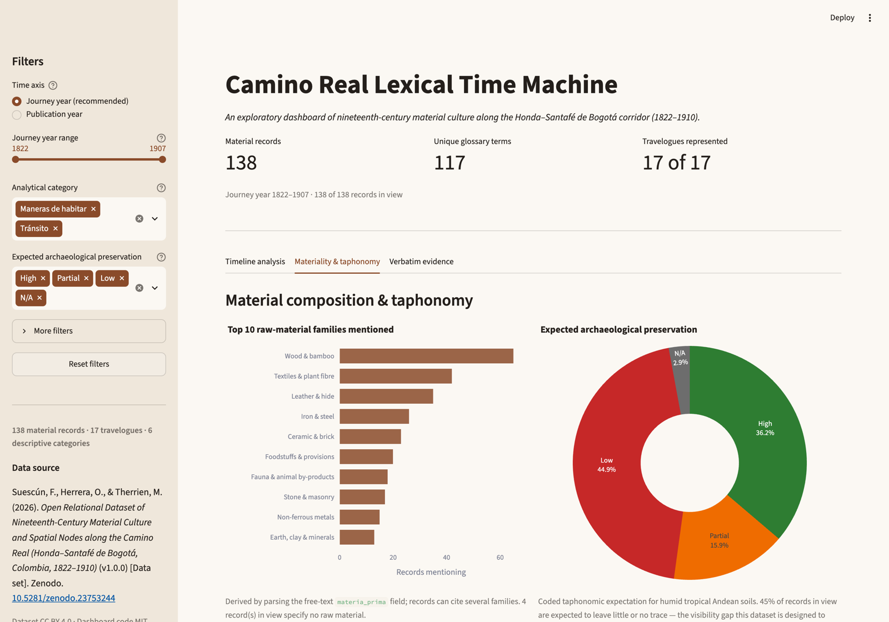

# Camino Real Lexical Time Machine

An interactive Streamlit dashboard for exploring 90 years of material-culture
data extracted from 17 nineteenth-century travelogues along the Camino Real
between Honda and Santafé de Bogotá, Colombia (1822–1910).

It is the exploratory layer of the open dataset
**Suescún, Herrera & Therrien (2026), _Open Relational Dataset of
Nineteenth-Century Material Culture and Spatial Nodes along the Camino Real_**,
deposited on Zenodo ([10.5281/zenodo.23753244](https://doi.org/10.5281/zenodo.23753244),
CC BY 4.0). The dashboard is a companion to the JOAD data paper, not a
replacement for reading the sources.

---

## Preview




---

## What it does

| Tab | Purpose |
| --- | --- |
| **Timeline analysis** | Material-culture mentions over time, split by analytical category *Tránsito* / *Maneras de habitar* (or by the six descriptive categories), at exact-year or decade resolution. Surfaces peaks, gaps and shifts in the vocabulary of transit and dwelling. |
| **Materiality & taphonomy** | Top raw-material families mentioned, and the expected archaeological preservation (High / Partial / Low / N/A) of the same records. This is the visibility gap the dataset was built to quantify. |
| **Verbatim evidence** | Full-text search across quotes, English summaries, glossary terms and raw materials; the filtered evidence table; CSV export; and a card view for close reading. |

Filters in the sidebar: time axis and year range, analytical category and
expected preservation; descriptive category, material family, source language
and corpus role sit under **More filters**. A **Reset filters** button restores
the full corpus.

---

## Quick start

Requires **Python 3.11+** (tested on 3.12).

```bash
cd camino-lexical-time-machine
python3.12 -m venv .venv
source .venv/bin/activate        # Windows: .venv\Scripts\activate
pip install -r requirements.txt
streamlit run app.py
```

The app opens at <http://localhost:8501>. The two CSV tables must sit in the
same folder as `app.py`; the app stops with a clear message if they are missing.

### Deploy to the web (portfolio URL)

1. Create a GitHub repository, e.g. `camino-lexical-time-machine`.
2. Push `app.py`, `requirements.txt`, `runtime.txt`, `.streamlit/config.toml`,
   `smoke_test.py`, `README.md`, `LICENSE` and the two CSV files (the
   `.gitignore` already excludes the venv and local exports).
3. Go to <https://share.streamlit.io>, log in with GitHub, choose **New app**,
   select the repo, branch `main` and main file `app.py`.
4. Deploy. No secrets or external services are needed; all data is bundled.

The citation block and the dataset DOI are rendered in the app, so the public
URL can go straight into a CV or the Zenodo description.

---

## Repository layout

```text
camino-lexical-time-machine/
├── app.py                        # the entire Streamlit application
├── requirements.txt              # tested pins
├── runtime.txt                   # Python 3.12 for Streamlit Community Cloud
├── smoke_test.py                 # 8 headless AppTest checks
├── 01_obras_corpus.csv           # verbatim from Zenodo v1.0.0 (17 rows)
├── 03_evidencia_material.csv     # verbatim from Zenodo v1.0.0 (138 rows)
├── .streamlit/config.toml        # theme
├── docs/                         # screenshots used in this README
├── .gitignore
├── LICENSE                       # MIT for the code
└── README.md
```

---

## Data provenance

Both CSVs are copied **byte-identically** from the Zenodo deposit
`Zenodo_Deposit_Camino_Real_v1.0.zip` (v1.0.0, 2026-10-28). No cell was edited.

| File | Rows | SHA-256 |
| --- | ---: | --- |
| `01_obras_corpus.csv` | 17 | `30986e425a39522900ba7ac863001721f8008eb54f985c1910bede0f54edcc1e` |
| `03_evidencia_material.csv` | 138 | `5b2c6043922ffd0aaedab1397e723115d074fa2e96e4af7faf96ed8b9d5ba9d1` |

Content: 138 material-culture records from 17 travelogues, coded into six
descriptive categories and two analytical domains, each with the verbatim quote
in its original language (English, French, Spanish, German, Portuguese), an
English analytical summary, a controlled glossary term, the raw-material
composition and the expected taphonomic preservation.

Dataset licence: **CC BY 4.0** — attribution required when reusing it.
Code in this repository: **MIT** (see `LICENSE`).

---

## Analytical decisions (and where they depart from the brief)

Everything analytical is computed at load time in `app.py`; the CSVs stay
untouched, so the derivation can be audited and reversed.

| Derived field | Built from | Rule |
| --- | --- | --- |
| `anio_edicion_anchor` | `anio_edicion` | First four-digit year of the edition statement: `1824-1825 → 1824`, `c. 1884 → 1884`. |
| `anio_jornada_anchor` | `anio_jornada` | Midpoint (rounded down) of the documented journey/stay: `1850-1851 → 1850`. |
| `preservacion_clase` | `preservacion_arqueologica_esperada` | Leading token collapsed to **High / Partial / Low / N/A**; anything else becomes **Unspecified**. The original free-text coding is still shown in the evidence table. |
| `material_families` | `materia_prima` | Composition string tokenised and mapped onto 16 broad families with an ordered keyword lexicon. A record may belong to several families. |
| `_search_text` | 11 text fields | Accent-folded, lower-cased concatenation so `Bogota` matches `Bogotá` and `piano` finds the piano records. |

**Departures from the brief in `Context.pdf`, and why**

1. **Time axis.** The brief filters on *publication year* and casts it as an
   `int`. The field is not an integer — it contains `1824-1825`, `1883-1884`
   and `c. 1884`, so the brief's `astype(int)` raises. More importantly,
   publication lags observation by decades: Le Moyne travelled in 1828–1839 and
   published in **1880**; Ancízar travelled in 1850–1851 and published in 1853.
   The app therefore defaults to the **journey year**, which dates the
   observation, and keeps **publication year** as a switchable axis for readers
   who want the brief's framing. Both are computed for every record.
2. **Preservation pie.** The field holds 124 distinct free-text strings
   (`Low (organic leather)`, `Partial (brass/bronze stirrups and spurs)`, ...).
   A pie of 124 slices is unreadable, and the brief's colour map only defines
   High/Partial/Low/N/A, so the app collapses the field to those four classes
   plus `Unspecified` and keeps the original coding in the table.
3. **Raw materials bar chart.** `materia_prima` has 138 distinct composition
   strings across 138 rows, so `value_counts()` would plot 138 bars of height 1.
   The app tokenises the field into material families (wood, leather and hide,
   iron and steel, ceramic and brick, textiles and plant fibre, ...) and counts
   records mentioning each. The chart title and caption state that a record can
   cite several families and that the raw field is available verbatim in the
   table.
4. **Search scope.** The brief's search box filters only the evidence table,
   which is preserved. It is accent-insensitive and also covers the original
   term, the glossary term, the raw materials and the author — not just the
   visible columns.
5. **Small additions** (all additive, none changes the requested views):
   colouring the timeline by descriptive category, an exact-year / decade
   resolution switch (the sampling is sparse: 16 sampled years over 90),
   source-language and corpus-role filters, a reset button, CSV export of the
   current selection, a card-reading view, and the About panel documenting the
   coding.

Numbers used in the app and tests: 138 records · 17 travelogues · 117 unique
glossary terms · 81 *Tránsito* / 57 *Maneras de habitar* records · preservation
High 50, Partial 22, Low 62, N/A 4.

---

## Verification

```bash
python smoke_test.py
```

Runs the app headlessly through Streamlit's `AppTest` harness — no browser
needed. Checks: dataset row counts and unique terms; default render (title,
metrics, evidence table); publication-year axis switch; category and
preservation filters; year-range slider; decade resolution; full-text search
(`piano` → 4 records); the empty state; and the reset button. All 9 checks pass
on the versions pinned in `requirements.txt`:

```text
streamlit 1.66.1 · pandas 3.1.0 · plotly 7.1.0 · Python 3.12.14
```

---

## How to read it honestly

- The corpus is small: 138 records over 90 years, 17 works. Year-on-year
  movement is thin and partly reflects **sampling** — who travelled, who
  published, and which stretches of road they wrote about.
- The preservation share is an **expectation coded by the dataset authors**,
  not an observed assemblage. It is the hypothesis to test in the field, not a
  result.
- Material families are a **research aid** derived from free text, not a
  controlled vocabulary. Check the verbatim `materia_prima` column before
  quoting a family count.
- `anio_jornada` sometimes spans a whole career (Bennett 1847–1877); its
  midpoint is a coarse anchor, documented by the caption and the About panel.

## Roadmap

- A route-node view from `04_mencion_referentes.csv` (145 mentions, 83
  landmarks) joined to historical cartography.
- Decade/period aggregation for the timeline, with confidence bands.
- A benchmark panel comparing the human coding with an LLM extraction pipeline.

---

## Citation

> Suescún, F., Herrera, O., & Therrien, M. (2026). *Open Relational Dataset of
> Nineteenth-Century Material Culture and Spatial Nodes along the Camino Real
> (Honda–Santafé de Bogotá, Colombia, 1822–1910)* (v1.0.0) [Data set]. Zenodo.
> https://doi.org/10.5281/zenodo.23753244

If you use the dashboard, please cite the dataset above and link this repository.
