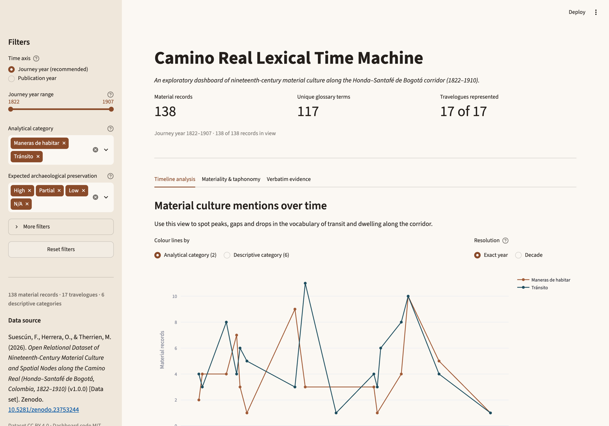

# Camino Real Lexical Time Machine

Exploratory Streamlit dashboard for the material culture recorded in 17
nineteenth-century travelogues along the Camino Real between Honda and Santafé
de Bogotá, Colombia (1822–1910).

**Live app:** <https://camino-lexical-time-machine.streamlit.app> ·
**Dataset:** [10.5281/zenodo.23753244](https://doi.org/10.5281/zenodo.23753244)

[](https://camino-lexical-time-machine.streamlit.app)
[](https://doi.org/10.5281/zenodo.23753244)



## Features

- **Timeline analysis** — records per year or decade, split by analytical
  category (*Tránsito* / *Maneras de habitar*) or by the six descriptive
  categories.
- **Materiality and taphonomy** — raw-material families and expected
  archaeological preservation (High / Partial / Low / N/A).
- **Verbatim evidence** — search across quotes, English summaries, glossary
  terms, materials and authors; evidence table, CSV export and card view.
- **Filters** — time axis and range, analytical and descriptive categories,
  preservation class, material family, source language and corpus role.

## Run locally

Requires Python 3.11+.

```bash
python3.12 -m venv .venv
source .venv/bin/activate        # Windows: .venv\Scripts\activate
pip install -r requirements.txt
streamlit run app.py
```

The app opens at <http://localhost:8501>. Both CSV tables must sit beside
`app.py`.

Headless checks: `python smoke_test.py` (9 checks via Streamlit `AppTest`).
Tested with streamlit 1.66.1, pandas 3.1.0 and plotly 7.1.0 on Python 3.12.

## Data

Both tables are copied byte-identically from the Zenodo deposit
`Zenodo_Deposit_Camino_Real_v1.0.zip` (v1.0.0, 2026-10-28); no cell was edited.

| File | Rows | SHA-256 |
| --- | ---: | --- |
| `01_obras_corpus.csv` | 17 | `30986e425a39522900ba7ac863001721f8008eb54f985c1910bede0f54edcc1e` |
| `03_evidencia_material.csv` | 138 | `5b2c6043922ffd0aaedab1397e723115d074fa2e96e4af7faf96ed8b9d5ba9d1` |

138 material-culture records from 17 travelogues, coded into six descriptive
categories and two analytical domains. Each record carries the verbatim quote in
its original language (English, French, Spanish, German, Portuguese), an English
analytical summary, a controlled glossary term, raw-material composition and
expected taphonomic preservation.

Dataset: **CC BY 4.0**. Code: **MIT** (see `LICENSE`).

## Derived fields

Computed at load time; the CSV tables are untouched.

| Field | Source | Rule |
| --- | --- | --- |
| `anio_edicion_anchor` | `anio_edicion` | First four-digit year of the edition statement: `1824-1825 → 1824`, `c. 1884 → 1884`. |
| `anio_jornada_anchor` | `anio_jornada` | Midpoint (rounded down) of the documented journey/stay: `1850-1851 → 1850`. |
| `preservacion_clase` | `preservacion_arqueologica_esperada` | Leading token collapsed to High / Partial / Low / N/A; anything else becomes Unspecified. The original free-text coding remains in the evidence table. |
| `material_families` | `materia_prima` | Composition string tokenised and mapped onto 16 material families with an ordered keyword lexicon. A record may cite several families. |
| `_search_text` | 11 text fields | Accent-folded, lower-cased concatenation, so `Bogota` matches `Bogotá`. |

## Repository layout

```text
camino-lexical-time-machine/
├── app.py                        # Streamlit application
├── requirements.txt              # pinned dependencies
├── runtime.txt                   # Python 3.12 for Streamlit Community Cloud
├── smoke_test.py                 # 9 headless AppTest checks
├── 01_obras_corpus.csv           # verbatim from Zenodo v1.0.0 (17 rows)
├── 03_evidencia_material.csv     # verbatim from Zenodo v1.0.0 (138 rows)
├── .streamlit/config.toml        # theme
├── docs/                         # screenshots
├── .gitignore
├── LICENSE
└── README.md
```

## Notes

- 138 records over 90 years across 17 works; year-on-year series are sparse and
  partly reflect sampling of travelogues.
- Preservation values are taphonomic expectations coded by the dataset authors,
  not observed assemblages.
- Material families are derived from the free-text `materia_prima` field with a
  keyword lexicon; counts are mention counts, and a record may cite several.
- `anio_jornada` spans covering several years use the midpoint as anchor.

## Citation

> Suescún, F., Herrera, O., & Therrien, M. (2026). *Open Relational Dataset of
> Nineteenth-Century Material Culture and Spatial Nodes along the Camino Real
> (Honda–Santafé de Bogotá, Colombia, 1822–1910)* (v1.0.0) [Data set]. Zenodo.
> https://doi.org/10.5281/zenodo.23753244

The dashboard is deployed at <https://camino-lexical-time-machine.streamlit.app>.
